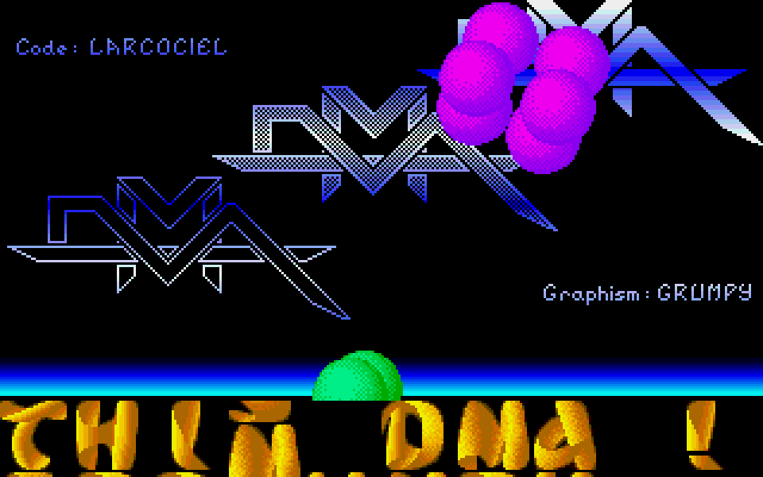
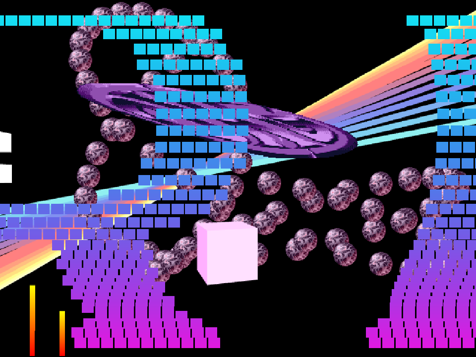

# CODEF — DMA & Oxygene in the browser

A collection of **14 demoscene recreations in HTML and JavaScript**, adapted
from the companion Go/Ebitengine projects using
[CODEF (Canvas Oldschool Demo Effects Framework)](https://github.com/N0NameN0/CODEF).

Thirteen screens revisit Atari ST productions by **DMA**. **Leonard/Oxygene's
Old skool Demo — second edition** comes from a Windows/DirectX 8 production.
The browser versions reuse the Go projects' artwork, bitmap fonts, palettes,
motion tables and YM chip music, with a shared **50 Hz simulation clock**.

Everything needed for playback is included: open an HTML file in a modern
browser, enable sound and enjoy. No build step, npm dependencies or Go
installation is required.

## Screenshots

**1st Vectorball Demo On The ST — Larcociel / DMA**

[](docs/screenshots/larcociel-vectorball.png)

**Old skool Demo — second edition — Leonard / Oxygene**

[](docs/screenshots/leonardintrodx.png)

Both screenshots were captured from these browser ports.

## Run locally

Download or clone the repository, then open **[index.html](index.html)** in your
browser and select a demo. You can also open any of the individual HTML entry
points listed below. Keep the repository's directory structure intact.

The pages work directly from disk (`file://`): scripts, graphics and music are
bundled locally, including embedded asset data for direct file access.

To use a local HTTP server instead, run this from the repository root:

```sh
python3 -m http.server 8000 --bind 127.0.0.1
```

Then visit [http://127.0.0.1:8000/](http://127.0.0.1:8000/).
Python is only needed for this optional server; any static HTTP server works.

The interface is in French. Click **Activer le son** (Enable sound), or press
**M**, to enable audio. **Never Mind** and **Raster Master** show an opening
card first: press **Enter** or **Space**, or click/tap the screen, to start.

## Included demos and Go sources

The companion Go projects use **Ebitengine** and **Demo Construction Kit**.
Their READMEs document the original productions, asset extraction and
verification work behind these browser adaptations.

| Demo / HTML entry point | Original author | Highlights | Companion Go project |
| --- | --- | --- | --- |
| [Chonchon](chonchon.html) | Chon-Chon / DMA | Metallic logos, a scrolling ribbon, star paths and music meters | [go-chonchon](https://github.com/olivierh59500/go-chonchon) |
| [Chonchon 2](chonchon2.html) | Chon-Chon / DMA | Moving panels, animated sprites, colored scrolltext and seven selectable tunes | [go-chonchon2](https://github.com/olivierh59500/go-chonchon2) |
| [Never Mind](jinx-nevermind.html) | Jinx / DMA | Nine sprite trajectories, ten sprite artworks, wave scrolling and music meters | [go-jinx-nevermind](https://github.com/olivierh59500/go-jinx-nevermind) |
| [Raster Master](jinx-rastermaster.html) | Jinx / DMA | Deformed logos, layered rasters, parallax scrolling and ten selectable tunes | [go-jinx-rastermaster](https://github.com/olivierh59500/go-jinx-rastermaster) |
| [Move The Mouse!!! / DMA Intro 1](larcociel-movethemouse.html) | Larcociel / DMA | An interactive logo, moving moons and a checkerboard landscape | [go-larcociel-movethemouse](https://github.com/olivierh59500/go-larcociel-movethemouse) |
| [1st Vectorball Demo On The ST](larcociel-vectorball.html) | Larcociel / DMA | Fourteen object sequences, shaded sphere sprites and a gold scrolling ribbon | [go-larcociel-vectorball](https://github.com/olivierh59500/go-larcociel-vectorball) |
| [DMA Intro 2](larcociel2.html) | Larcociel / DMA | Perspective spheres, a moving checkerboard and an adjustable projection center | [go-larcociel2](https://github.com/olivierh59500/go-larcociel2) |
| [DMA Intro 3 / French Demo](larcociel3.html) | Larcociel / DMA | A curved French scrolltext, DMA sprite trails, rasters and an animated landscape | [go-larcociel3](https://github.com/olivierh59500/go-larcociel3) |
| [DMA Intro 4](larcociel4.html) | Larcociel / DMA | Illustrated characters, sparkles and repeated scrolling text driven by palette changes | [go-larcociel4](https://github.com/olivierh59500/go-larcociel4) |
| [DMA Intro 5](larcociel5.html) | Larcociel / DMA | Batman music meters, a moving ribbon and scrolltext projected onto a perspective floor | [go-larcociel5](https://github.com/olivierh59500/go-larcociel5) |
| [Old skool Demo — second edition](leonardintrodx.html) | Leonard / Oxygene | A rotating cube, ball sprites, pastel ribbons, a warped logo and two block scrollers | [go-leonardintrodx](https://github.com/olivierh59500/go-leonardintrodx) |
| [Lockbuster 2](lockbuster2.html) | Lockbuster / DMA | Six scrolling effects, mirrored text, raster colors and selectable palettes | [go-lockbuster2](https://github.com/olivierh59500/go-lockbuster2) |
| [Lockbuster 3](lockbuster3.html) | Lockbuster / DMA | Turning DMA panels, animated letters, scrolling text and three music meters | [go-lockbuster3](https://github.com/olivierh59500/go-lockbuster3) |
| [The Nitro Intro](mad-nitro.html) | Mad / DMA | Wave and vertical scrolling, reflected text, rainbow rasters and an animated DMA title | [go-mad-nitro](https://github.com/olivierh59500/go-mad-nitro) |

Most screens have a logical resolution of **320 × 200**. Never Mind uses
**320 × 270**, Lockbuster 3 and The Nitro Intro use **320 × 240**, and Old skool
Demo uses **640 × 480**. The canvas scales to the browser window with pixelated
rendering. Simulation advances at 50 updates per second independently of the
display refresh rate.

## Controls

### Common controls

| Action | Button / key |
| --- | --- |
| Enable or mute sound | **Activer le son** / **Couper le son**, or **M** |
| Pause or resume animation and audio | **Pause** / **Reprendre**, **P**, **Escape**, or **Space** after the opening card |
| Enter or leave fullscreen | **Plein écran** button |

Audio starts muted and is enabled by a user gesture. Animation and audio
suspend while the browser tab is hidden.

### Demo-specific controls

Mouse and touch actions below refer to the demo canvas. "Left half" and
"right half" describe where to click or tap on the image.

| Demo | Controls |
| --- | --- |
| Chonchon 2 | **F1–F7** select a tune; click/tap to select the next tune. |
| Never Mind | **Enter**, **Space** or click/tap starts the scene. **1–9** select a trajectory; **F1–F10** select sprite artwork. Click/tap the left half for the next trajectory or the right half for the next sprite. |
| Raster Master | **Enter**, **Space** or click/tap starts the scene. **F1–F10** select a tune; **H** or **Insert** toggles the blue background. Click/tap the left half to toggle the background or the right half for the next tune. |
| Move The Mouse!!! | Move the mouse, or drag a finger horizontally, to deform the DMA logo. |
| DMA Intro 2 | **Arrow keys** move the projection center; touching the canvas places it at the touch position. |
| Lockbuster 2 | **F1/F2** select gold/metallic text; **F3/F4** select a colored/black text background; **F5/F6** select alternate/original rasters. Click/tap the left half to change the text palette or the right half to switch its background. |
| Old skool Demo | **W** toggles wireframe rendering; **Tab** toggles the load indicator. Effects enter progressively during the first 36 seconds. |

## Project layout

| Path | Purpose |
| --- | --- |
| `index.html` | Collection index linking to all 14 demos |
| `thumbnails/` | Preview images for the collection index |
| `<demo>.html` and `<demo>/index.html` | Two entry points for the same demo |
| `<demo>/demo.js` | ES module version of the scene logic |
| `<demo>/demo.classic.js` | Classic script version loaded by the HTML pages |
| `<demo>/assets/` | Images, fonts, palettes, messages, motion data and YM tracks |
| `<demo>/assets.js` | Embedded asset bundle used for direct file access |
| `<demo>/assets.json` | Asset names and byte sizes |
| `shared/` | Shared runtime and page styling |
| `vendor/codef/` | Bundled CODEF core, music player and 3D support |
| `docs/screenshots/` | Browser captures used in this README |

The HTML pages load `shared/runtime.classic.js` and each demo's
`demo.classic.js`. When changing scene or runtime code, keep the corresponding
ES module and classic script versions aligned. Asset changes also need to be
reflected in the embedded bundle.

## Credits and music

Original production authors are listed alongside each demo above. Additional
credits documented in the companion projects include **Grumpy** for Vectorball
graphics, **David Whittaker** for its music, **Jason C. Brooke** for DMA Intro 3
music, **Ming** for The Nitro Intro's font, and **Mon/Oxygene** for the Old skool
Demo logo.

The bundled YM files are the same as those in the Go projects. Chonchon,
Chonchon 2, Never Mind, Raster Master and Lockbuster 2 use replacement tracks
arranged by **Mad Max (Jochen Hippel)**, as documented upstream. Old skool Demo
uses **Bankok Knights**, arranged by **Big Alec/Delta Force** from **Matt Gray's**
C64 composition. Track-specific credits are retained in the YM files and the
companion projects.

The Go adaptations are by
[olivierh59500](https://github.com/olivierh59500), using
[Ebitengine](https://github.com/hajimehoshi/ebiten) and
[Demo Construction Kit](https://github.com/olivierh59500/democonstructionkit).

[CODEF](https://github.com/N0NameN0/CODEF) is by **Antoine Santo (N0NameN0)**
and contributors. The bundled upstream files retain their MIT license headers;
their source commit is recorded in [vendor/codef/UPSTREAM.txt](vendor/codef/UPSTREAM.txt).
More CODEF productions can be found at [We Are Back](https://www.wab.com/) and
[Mellow Man's CODEF pages](https://codef.namwollem.co.uk/).
